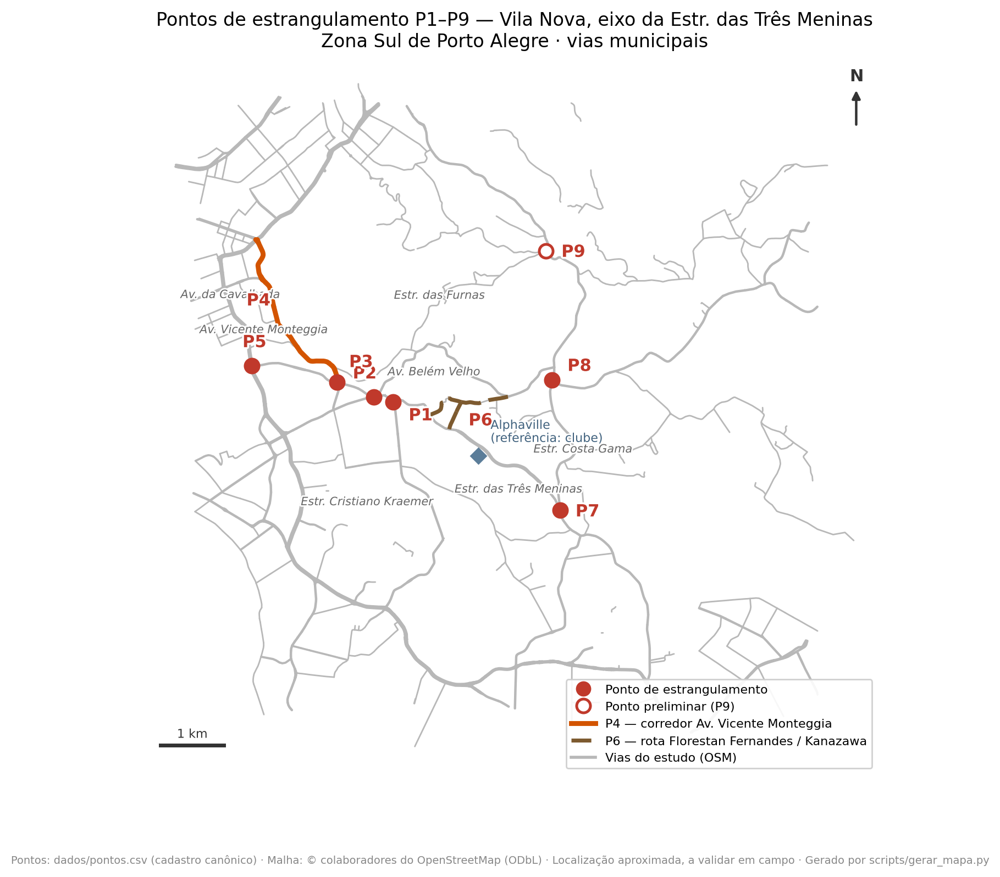

> **Versão histórica (aviso de 09/11/2026).** Este é o texto de setembro de 2026, preparado para a
> reunião de 22/09/2026 com a Diretoria da EPTC, e não foi atualizado depois. Já foram superados: (i)
> no **P2**, o projeto da GPTC-EPTC é o *implantado*, e a ata da reunião registra que o trevo não tem
> projeto atualmente; (ii) nos **sinistros**, a base oficial passou a ser a da EPTC (Pedido 17), e os
> números abaixo vêm da base auxiliar; (iii) as respostas LAI posteriores atualizam as desapropriações
> e as contrapartidas. **Posição atual:** `PENDENCIAS.md` e `relatorios/anexo-matriz-pontos.md`.

> **Finalidade deste documento.** Subsidiar, de forma resumida, a leitura prévia da
> Diretoria da EPTC antes da reunião com a comissão. Reúne o essencial do diagnóstico, o
> contexto documental e o que se pretende tratar no encontro. O material técnico completo
> (matriz dos pontos, mapa, agregados da sonda e cronologia documental) pode ser
> disponibilizado a pedido. **Todas as vias tratadas são de jurisdição municipal.**

## Quem somos

Somos uma comissão de moradores do entorno de Vila Nova (Zona Sul de Porto Alegre),
constituída para contribuir, de forma técnica e colaborativa, com a qualificação viária da
região — no eixo da Estr. das Três Meninas e vias conectadas. Nosso princípio é **somar à
atuação técnica da EPTC/SMMU e da SMAMUS, não substituí-la**: adotamos *diagnóstico antes da
solução* e priorizamos **medidas faseadas, começando pelas de menor custo** (sinalização,
ajuste de tempos semafóricos, qualificação de rotas).

## O tema em uma frase

Trata-se, em boa parte, de **concluir e atualizar intervenções viárias que o próprio
Município já pactuou, projetou e declarou de utilidade pública** no eixo da Estr. das Três
Meninas, e de qualificar a segurança e a fluidez em pontos críticos — não de propor obras
inteiramente novas.

## O diagnóstico, em síntese

A partir de relatos da comunidade e de uma análise preliminar de dados públicos,
identificamos **oito pontos de estrangulamento**, além de um ponto preliminar e duas
demandas de continuidade viária:

- **P1** — Rótula Estr. Três Meninas × Estr. Cristiano Kraemer;
- **P2** — Confluência Cristiano Kraemer × Av. Belém Velho × Av. Monte Cristo;
- **P3** — Acesso à Av. Vicente Monteggia (Rodrigues da Fonseca / João Salomoni);
- **P4** — Corredor da Av. Vicente Monteggia (prioridade de segurança);
- **P5** — Conversão Av. João Salomoni → Av. da Cavalhada;
- **P6** — Acesso à Av. Dr. Vergara (rota hoje não pavimentada — Florestan Fernandes / Kanazawa);
- **P7** — Acesso à Estr. Costa Gama, sentido bairro–centro (sem conversão à esquerda);
- **P8** — Cruzamento semaforizado Estr. Costa Gama × Estr. Afonso Lourenço Mariante;
- **P9** *(preliminar)* — Entroncamento Rua Santuário × Av. Oscar Pereira;
- **D2 / D3** — retorno seguro no eixo da Três Meninas e avaliação de capacidade da Estr. Cristiano Kraemer.

## Por que importa para a cidade

**Segurança viária.** A análise preliminar de sinistros (Dados Abertos POA, associação por
proximidade) aponta gravidade relevante, com destaque para o **corredor da Av. Vicente
Monteggia (P4)** — que registra feridos graves e **vítimas fatais** — e **envolvimento
recorrente de motociclistas** em vários pontos. *(Indicadores preliminares, a validar em
vistoria conjunta.)*

**Fluidez.** Uma sonda própria de tempos de viagem (Google Routes API, mais de 8.500
medições entre jul. e set./2026) indica, no pico, **atraso de ~1,3–1,4× no corredor do P4**,
um **custo de 2,0× no tempo do acesso legal à Estr. Costa Gama (P7)** frente ao movimento
direto, e o **maior índice de atraso no novo P9**. *(Indicadores próprios, indicativos; a
validar com contagens da EPTC.)*

**Alinhamento com as políticas municipais.** As demandas convergem com o **Plano de
Segurança Viária Sustentável (PSVS)** e a Visão Zero, e com a diretriz de redução do tempo
de deslocamento do novo marco urbanístico (PDUS/LUOS, sancionado em 14/07/2026).

## O contexto documental (o essencial)

A documentação oficial do licenciamento do empreendimento no eixo — reunida em jul.–set./2026
a partir de respostas a pedidos de acesso à informação e de documentos disponibilizados pela
administração do empreendimento — mostra que boa parte do que se pleiteia **já foi pactuada,
projetada e aprovada pelo próprio Município, sem conclusão**:

- há **Plano Funcional aprovado** para a Estr. das Três Meninas e um **Termo de Compromisso
  sem prazo de validade** (a cláusula que o limitava a 30 meses foi suprimida por aditivo em 2012);
- o **Parecer CTAAPS nº 093/2020**, do próprio Município, registra como **não implantadas** as
  segundas fases das interseções com a **Cristiano Kraemer (P1)**, a **Kanazawa e a Florestan
  Fernandes (P6)** e a **Costa Gama (P7)**, e aponta a **ausência de projeto de drenagem** para
  as adequações de P1 e P7;
- **três decretos de 23/12/2020** (nº 20.859, 20.860 e 20.861) declararam de utilidade pública
  as áreas necessárias ao alargamento, inclusive a da **"alça de ligação" com a Estr. Costa
  Gama (P7)**;
- o **projeto geométrico** dessa conexão, aprovado na CTAAPS em 2013, **perdeu a validade**
  (Decreto nº 20.659/2020) — e a **própria EPTC recomendou, em 2020, revisar os projetos** em
  razão do tempo decorrido.

Em 2026, a PGM individualizou parte do quadro fundiário (desapropriações em diferentes
estágios; a DUP do P6 caducou em 28/12/2025, com novo decreto previsto); a questão financeira
vinculada (Cláusula Nona) foi remetida à Secretaria Municipal da Fazenda. Em resumo: para
vários pontos é possível **partir de soluções que a cidade já projetou e cujas áreas já
declarou de utilidade pública** — a serem revalidadas, atualizadas e concluídas.

## Quem executa cada obrigação

Um ponto que ajuda a orientar os encaminhamentos: os instrumentos já definem **de quem é a
responsabilidade pela execução** de cada intervenção pactuada. O quadro abaixo resume o que a
documentação indica — a **confirmar e atualizar** com a EPTC/SMMU, a SMAMUS e a PGM.

| Intervenção | Responsável pela execução (conforme os instrumentos) |
|---|---|
| **Obras** do corredor e das interseções pactuadas — P1, P2/P3, P6, P7 | **Empreendedor do Alphaville** (Villa Nova Desenvolvimento Urbano), como medida do licenciamento. A PGM confirmou (Pedido 8, 2026) que a **caducidade dos projetos não desobriga** a execução — devem ser revalidados por ocasião da obra. |
| **Desapropriações** das áreas do traçado (P1, P6, P7) | **Município** — declara, orça e efetiva (PGM/SMF), com **aporte de R$ 200 mil do empreendedor** (Cláusula Nona). Quadro individualizado pela PGM em 2026. |
| **Aprovação/revalidação** dos projetos geométrico e de sinalização | **SMMU/EPTC** (validade de 4 anos; a própria EPTC recomendou a revisão em 2020). |
| Alargamento e sinalização no **trecho lindeiro ao novo empreendimento** (afeta P1 e P6) | **Nova incorporadora** (Chácara das Três Meninas Empreendimentos), via **Termo de Compromisso** próprio, condicionante ao Habite-se (Parecer CAUGE nº 048/2025). |
| **P4** (Av. Vicente Monteggia), **P5** e **P8** — *fora do Termo de Compromisso* | **Município / EPTC-SMMU** (pleito novo; há precedente de execução direta municipal no eixo do P4). |

## Uma sinergia com a EPTC

O **P2** conversa diretamente com o **projeto de qualificação viária da Av. Monte Cristo
(PSVS)**, cujo trecho se encerra na Estr. Cristiano Kraemer. O nó específico do P2 tem
**projeto próprio, elaborado pela GPTC-EPTC**, com manifestação da EPTC ainda pendente —
oportunidade concreta de integrar parte das melhorias a iniciativa já em curso.

## O que gostaríamos de tratar na reunião

1. **Vistoria técnica conjunta** dos pontos indicados;
2. **Disponibilização dos dados disponíveis** — tempos semafóricos, sinistros
   georreferenciados e contagens —, conforme as possibilidades da EPTC;
3. **Acesso aos desenhos vigentes e ao status de implantação** do Plano Funcional (incluindo
   a conexão com a Costa Gama), com **avaliação de revalidação/atualização** das soluções já
   projetadas;
4. **Abertura de um canal técnico de diálogo** para o encaminhamento das demandas;
5. **Avaliação de medidas rápidas e de baixo custo** (por exemplo, ajustes de tempos
   semafóricos) nos pontos em que a vistoria e os dados confirmarem evidência suficiente.

## Observação metodológica

Nosso material **não pretende substituir a avaliação técnica da EPTC/SMMU**. Os dados de
sinistros são associação preliminar por proximidade (não prova de causa) e os tempos de
viagem são indicadores próprios e indicativos. A **validação técnica da autoridade competente
é justamente o que buscamos** — e o motivo desta aproximação colaborativa.

---

**Comissão Viária Estrada das Três Meninas**
Representante: Eduardo de Oliveira Horta · comissao.viaria@outlook.com
